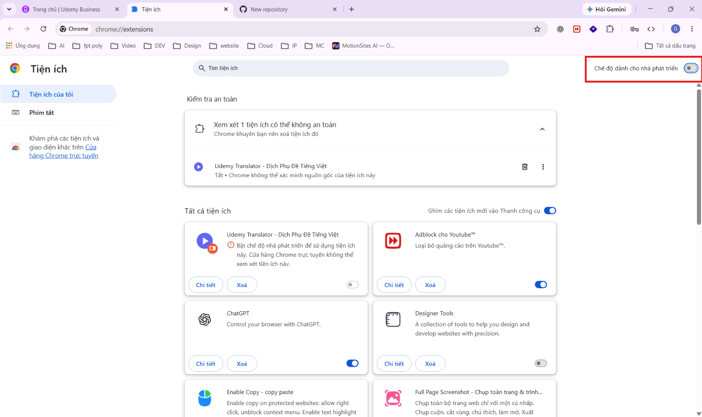
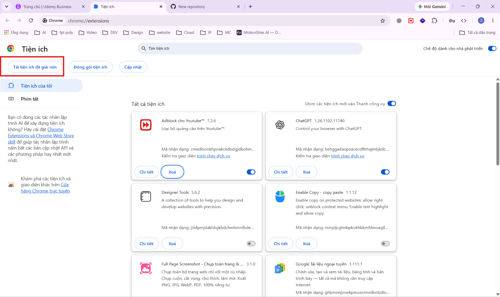
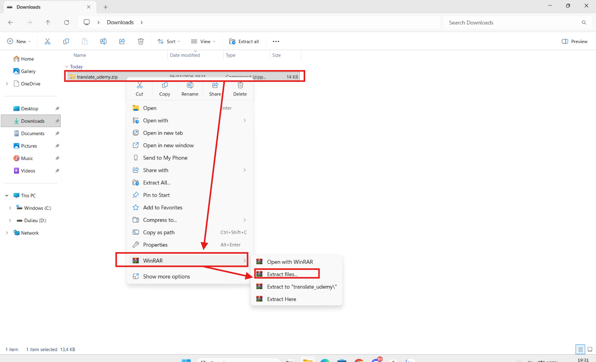
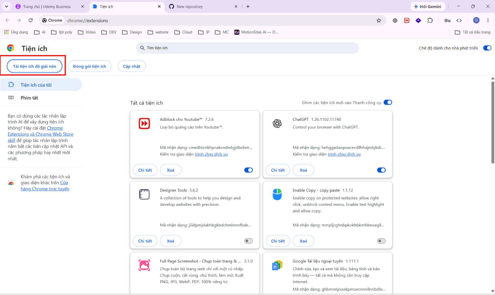
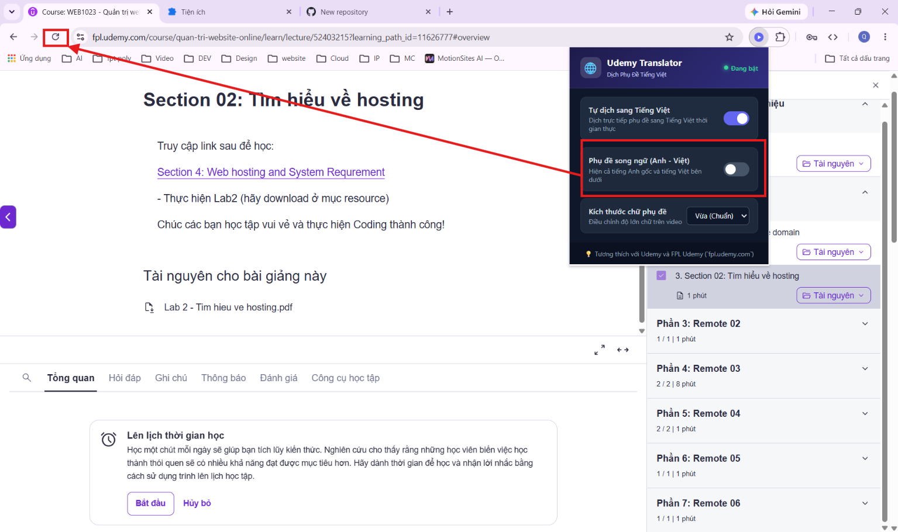

# 🌐 Udemy Translator - Dịch Phụ Đề Tiếng Việt Cho Udemy

> 🛡️ **Bản quyền tiện ích được tạo bởi Dev yanfeii_9999**

Tiện ích mở rộng dành cho trình duyệt (**Google Chrome, Microsoft Edge, Cốc Cốc, Brave...**) giúp **tự động dịch phụ đề bài giảng Udemy sang Tiếng Việt theo thời gian thực**, hỗ trợ học tập mượt mà và trực quan.

---

## ✨ Các Tính Năng Nổi Bật

- ⚡ **Dịch thời gian thực siêu tốc**: Tự động bắt phụ đề bài giảng và dịch sang Tiếng Việt qua Google Translate API, phụ đề hiển thị khớp theo từng câu nói của giảng viên.
- 💬 **Hỗ trợ Song ngữ (Anh - Việt)**: Tùy chọn hiển thị đồng thời cả tiếng Anh gốc lẫn tiếng Việt bên dưới, giúp bạn vừa tiếp thu kiến thức vừa nâng cao vốn từ vựng chuyên ngành.
- 👁️ **Chống đè chữ thông minh**: Tự động ẩn phụ đề gốc của Udemy khi bật tiếng Việt để tránh tình trạng chữ đè lên nhau gây khó đọc.
- 🔤 **Tùy chỉnh kích thước phụ đề**: Dễ dàng chuyển đổi giữa 3 kích cỡ (Nhỏ / Vừa / Lớn), tương thích tốt ngay cả khi xem toàn màn hình (Fullscreen).
- 🎯 **Tự kích hoạt CC**: Tự động bật phụ đề của video nếu bạn quên chưa bật.
- 🎓 **Hỗ trợ đầy đủ**: Hoạt động hoàn hảo trên cả **Udemy thông thường** (`udemy.com`) và **FPL Udemy** (`fpl.udemy.com`).

---

## 📸 Hướng Dẫn Cài Đặt & Sử Dụng Từng Bước (Kèm Ảnh)

### 🔹 Bước 1: Mở trang Quản lý Tiện ích & Bật Chế độ Nhà phát triển
1. Mở trình duyệt Chrome (hoặc Edge, Cốc Cốc).
2. Nhập vào thanh địa chỉ: `chrome://extensions` (với Edge là `edge://extensions`) rồi nhấn **Enter**.
3. Gạt bật công tắc **"Chế độ dành cho nhà phát triển"** (*Developer mode*) ở góc trên cùng bên phải màn hình.

---

### 🔹 Bước 2: Quan sát thanh công cụ quản lý tiện ích
- Sau khi bật chế độ nhà phát triển, ở góc trên bên trái sẽ xuất hiện các nút chức năng mới, đặc biệt là nút **"Tải tiện ích đã giải nén"** (*Load unpacked*).

---

### 🔹 Bước 3: Tải về và Giải nén thư mục tiện ích
1. Tải file `translate_udemy.zip` về máy tính của bạn (mặc định nằm trong thư mục *Downloads*).
2. Nhấp **chuột phải** vào file `translate_udemy.zip`.
3. Chọn mục **WinRAR** ➔ chọn **Extract files...** (hoặc chọn *Extract to "translate_udemy\"*) để giải nén ra thư mục.

---

### 🔹 Bước 4: Nạp thư mục tiện ích vào trình duyệt
1. Quay lại tab **Tiện ích** (`chrome://extensions`) trên trình duyệt.
2. Nhấn vào nút **"Tải tiện ích đã giải nén"** (*Load unpacked*) ở góc trên bên trái.
3. Chọn đúng thư mục `translate_udemy` bạn vừa giải nén ở Bước 3 rồi nhấn **Select Folder** (hoặc *Chọn Thư mục*).
4. Tiện ích **Udemy Translator** sẽ hiển thị trong danh sách tiện ích của trình duyệt.

---

### 🔹 Bước 5: Mở bài giảng Udemy & Tùy chỉnh theo ý muốn
1. Truy cập vào khóa học bất kỳ trên **Udemy** hoặc **FPL Udemy** (`fpl.udemy.com`).
2. Nhấn phím **F5** (hoặc bấm vào **biểu tượng tải lại trang 🔄**) trên thanh địa chỉ của trình duyệt để nạp tiện ích vào video.
3. Nhấp vào biểu tượng tiện ích **Udemy Translator** trên thanh công cụ để mở bảng điều khiển:
   - **Tự dịch sang Tiếng Việt**: Bật / Tắt dịch phụ đề nhanh chóng.
   - **Phụ đề song ngữ (Anh - Việt)**: Gạt bật nếu muốn xem cả phụ đề tiếng Anh và tiếng Việt.
   - **Kích thước chữ phụ đề**: Chọn mức *Nhỏ*, *Vừa (Chuẩn)* hoặc *Lớn* sao cho dễ nhìn nhất.

---

## 💡 Mẹo Hữu Ích

- **Ghim tiện ích (Pin Extension)**: Nhấn vào biểu tượng mảnh ghép 🧩 trên góc trình duyệt ➔ chọn biểu tượng chiếc ghim 📌 cạnh **Udemy Translator** để tiện bật tắt chế độ song ngữ bất cứ lúc nào.
- **Khi đổi bài học**: Tiện ích sẽ tự động nhận diện và bắt phụ đề của video mới. Nếu video chưa bật phụ đề, tiện ích sẽ tự động kích hoạt giúp bạn.

---

## 📜 Bản Quyền & Tác Giả (License & Credits)

- **Bản quyền tiện ích được tạo bởi Dev yanfeii_9999**.
- Mọi thắc mắc, đóng góp ý kiến hoặc yêu cầu hỗ trợ xin vui lòng liên hệ tác giả: **Dev yanfeii_9999**.
